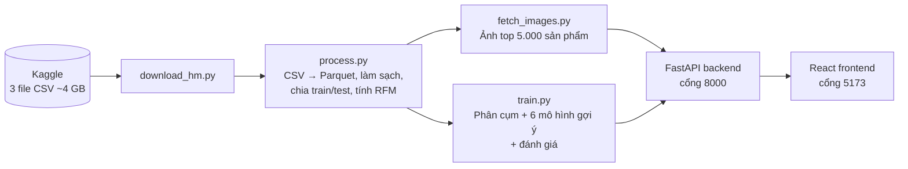

# Personalized Marketing – Mô tả chi tiết dự án

Đồ án Big Data: **phân cụm khách hàng** và **gợi ý sản phẩm cá nhân hóa** trên bộ dữ liệu **H&M Personalized Fashion Recommendations** (~31,8 triệu giao dịch thời trang trong 2 năm).

> Hướng dẫn cài đặt và chạy: xem [README.md](README.md).
>
> Các ô `…` là số liệu sẽ được điền sau khi chạy pipeline trên toàn bộ dữ liệu.

---

## 1. Giới thiệu

### 1.1. Bài toán

Một hãng thời trang có hơn một triệu khách hàng và hơn một trăm nghìn mẫu sản phẩm. Gửi cùng một chương trình khuyến mãi cho tất cả khách vừa tốn kém vừa kém hiệu quả: khách mua thường xuyên không cần voucher giảm giá nhỏ, còn khách sắp bỏ đi lại cần một lý do để quay lại. Với lượng sản phẩm lớn như vậy, khách cũng khó tự tìm được món hợp gu. Marketing cá nhân hóa giải quyết việc này bằng cách trả lời hai câu hỏi:

1. **Khách này thuộc nhóm nào?** → để chọn đúng chiến dịch.
2. **Khách này nên được gợi ý sản phẩm gì?** → để tăng khả năng mua.

### 1.2. Mục tiêu

- **Xây dựng pipeline xử lý dữ liệu lớn** (hàng chục triệu dòng) chạy được trên một máy tính cá nhân, bằng định dạng cột (Parquet) và xử lý lười (lazy evaluation) với Polars.
- **Phân cụm khách hàng** thành các nhóm có ý nghĩa kinh doanh dựa trên hành vi mua (RFM), kèm gợi ý chiến dịch cho từng nhóm.
- **Xây dựng và so sánh 6 mô hình gợi ý sản phẩm**, từ đơn giản (bán chạy nhất) đến phức tạp (kết hợp nhiều mô hình), đánh giá bằng các chỉ số chuẩn trên dữ liệu tương lai.
- **Xây dựng web demo** để người làm marketing tra cứu khách hàng, xem nhóm, xem gợi ý kèm ảnh sản phẩm thật và so sánh mô hình.

---

## 2. Dữ liệu

### 2.1. Nguồn và quy mô

Bộ dữ liệu do H&M Group công bố trong cuộc thi [H&M Personalized Fashion Recommendations](https://www.kaggle.com/competitions/h-and-m-personalized-fashion-recommendations) trên Kaggle (2022).

| Thông tin | Giá trị |
|---|---|
| Khoảng thời gian | 20/09/2018 – 22/09/2020 (~2 năm) |
| Số giao dịch | 31.788.324 |
| Số khách hàng | 1.371.980 |
| Số sản phẩm | 105.542 |
| Ảnh sản phẩm | ~105 nghìn ảnh (một ảnh cho mỗi sản phẩm) |
| Dung lượng | ~34,6 GB (3 file CSV ~4 GB, còn lại là ảnh) |

### 2.2. Ba bảng dữ liệu

| Bảng | Nội dung chính |
|---|---|
| `transactions_train.csv` | Mỗi dòng là một món hàng được mua: ngày mua (`t_dat`), mã khách (`customer_id`), mã sản phẩm (`article_id`), giá (`price`), kênh bán (`sales_channel_id`: online / cửa hàng) |
| `articles.csv` | Thông tin sản phẩm: tên, loại sản phẩm, nhóm sản phẩm, màu, phòng ban, mô tả chi tiết (`detail_desc`)... |
| `customers.csv` | Thông tin khách: tuổi, trạng thái thành viên câu lạc bộ, tần suất nhận tin thời trang... |

### 2.3. Đặc điểm cần lưu ý

- **Không có mã hóa đơn.** Hệ thống coi tất cả món một khách mua trong **cùng một ngày** là **một đơn hàng**.
- **Giá đã được H&M chuẩn hóa** (các số nhỏ như 0,05), không phải tiền tệ thật. Chỉ số Monetary vì vậy có ý nghĩa **so sánh giữa các khách**, không phải số tiền thực tế.
- **Mã khách là chuỗi mã hóa 64 ký tự.** Hệ thống đánh lại thành số nguyên ngắn để dùng trên web và API.
- **Không có giao dịch hủy hay trả hàng**, nên không cần bước lọc đơn hủy như các bộ dữ liệu bán lẻ khác.

---

## 3. Kiến trúc hệ thống

Các script Python chạy **một lần** để chuẩn bị dữ liệu và huấn luyện, kết quả được lưu thành file (Parquet, CSV, pickle, JSON). Backend chỉ nạp các file này và trả kết quả tức thì cho web, không phải xử lý lại hàng chục triệu dòng mỗi lần có yêu cầu.

| Thành phần | Công nghệ | Vai trò |
|---|---|---|
| Xử lý dữ liệu lớn | Polars (lazy, streaming), Parquet | Đọc 31,8 triệu dòng mà không nạp hết vào RAM, làm sạch, chia tập, tính RFM |
| Mô hình | scikit-learn, SciPy, implicit | K-Means, PCA, TF-IDF, Item-CF (scikit-learn, SciPy); ALS (implicit) |
| Backend | FastAPI, Pydantic | REST API, phục vụ ảnh tĩnh |
| Frontend | React, Vite | Giao diện web |
| Triển khai | Docker Compose, Nginx | Chạy toàn bộ hệ thống bằng một lệnh |

**Vì sao dùng Polars và Parquet thay cho pandas và CSV?** File giao dịch dạng CSV nặng ~3,5 GB. pandas phải nạp toàn bộ vào RAM, chiếm nhiều GB và dễ làm treo máy 16 GB. Polars đọc dạng lười: chỉ đọc những cột và dòng cần thiết, xử lý theo từng phần. Parquet lưu theo cột và nén, nên nhỏ hơn CSV nhiều lần và đọc nhanh hơn hàng chục lần.

<!-- TODO: thêm bảng so sánh thời gian / RAM giữa pandas + CSV và Polars + Parquet sau khi chạy thử -->

---

## 4. Quy trình xử lý dữ liệu

### 4.1. Làm sạch dữ liệu (`process.py`)

| Bước | Thao tác | Số dòng còn lại |
|---|---|---|
| – | Dữ liệu ban đầu (đã chuyển CSV → Parquet, ép kiểu ngày, `article_id` dạng chuỗi 10 ký tự) | 31.788.324 |
| 1 | Chỉ giữ dữ liệu từ `DATA_START_DATE` (mặc định 1 năm gần nhất: 23/09/2019 – 22/09/2020) | … |
| 2 | Bỏ dòng thiếu mã khách / mã sản phẩm hoặc giá ≤ 0 | … |
| 3 | **Gộp dòng trùng thành số lượng**: H&M ghi mỗi món là 1 dòng, nên mua 2 món giống hệt nhau trong cùng ngày tạo ra 2 dòng y hệt. Các dòng này được gộp lại với `quantity` = số dòng, thay vì xóa đi | … |
| 4 | Ghép tên sản phẩm từ `articles.csv`, bỏ giao dịch của sản phẩm không có thông tin | … |
| 5 | Đổi mã khách (chuỗi hash 64 ký tự) sang số nguyên ngắn | … |

<!-- TODO: điền số dòng sau mỗi bước từ log của process.py -->

**Vì sao chỉ lấy 1 năm gần nhất?** Thời trang thay đổi theo mùa và theo xu hướng, nên dữ liệu gần đây phản ánh sở thích hiện tại tốt hơn. Một năm vẫn bao trọn đủ 4 mùa. Bỏ bớt năm đầu còn giúp pipeline chạy vừa RAM laptop. Muốn dùng toàn bộ 2 năm chỉ cần đặt `DATA_START_DATE = None` trong `config.py`.

### 4.2. Chuẩn bị dữ liệu cho mô hình

**Chia train/test theo thời gian:** **28 ngày cuối** (25/08 – 22/09/2020) làm tập test, phần trước làm tập train.

Cách chia này mô phỏng đúng thực tế: dùng quá khứ để đoán tương lai. Nếu chia ngẫu nhiên, tập train sẽ chứa cả giao dịch tương lai, khiến mô hình "biết trước đáp án" và cho điểm cao ảo (rò rỉ dữ liệu – data leakage). Chọn 28 ngày vì khách thời trang mua lại khá nhanh; 4 tuần đủ để nhiều khách kịp quay lại mua mà vẫn giữ phần lớn dữ liệu cho tập train.

**Tính RFM trên tập train** (một đơn hàng = các món một khách mua trong cùng một ngày):

| Chỉ số | Ý nghĩa | Nhỏ nhất | Trung bình | Lớn nhất |
|---|---|---|---|---|
| **Recency** | Số ngày kể từ lần mua cuối | … | … | … |
| **Frequency** | Số đơn hàng (số ngày có mua) | … | … | … |
| **Monetary** | Tổng giá trị đã chi (giá chuẩn hóa) | … | … | … |

<!-- TODO: điền từ log của process.py -->

**Ma trận tương tác khách × sản phẩm:** chỉ giữ khách có ≥ 2 đơn hàng và sản phẩm có ≥ 20 lượt mua. Các mô hình gợi ý giới hạn ở **10.000 sản phẩm phổ biến nhất** và **50.000 khách** lấy ngẫu nhiên, vì ma trận độ tương đồng đầy đủ giữa 105 nghìn sản phẩm cần hàng chục GB RAM. Phân cụm RFM vẫn chạy trên toàn bộ khách. Khách không đủ điều kiện vẫn được gợi ý bằng mô hình Popularity.

| Thông tin | Giá trị |
|---|---|
| Số cặp (khách, sản phẩm) | … |
| Số khách trong ma trận | … |
| Số sản phẩm trong ma trận | … |

**Đáp án để chấm điểm (`test_truth`):** những sản phẩm khách thực sự mua trong 28 ngày cuối. Để thời gian đánh giá hợp lý, hệ thống **lấy ngẫu nhiên 10.000 khách** có trong ma trận tương tác và có mua trong tập test.

### 4.3. Ảnh sản phẩm (`fetch_images.py`)

- Ảnh là **ảnh thật của H&M**, đúng từng sản phẩm, lấy từ thư mục `images/` của cuộc thi.
- Bộ ảnh đầy đủ ~30 GB, nên chỉ tải ảnh của **5.000 sản phẩm bán chạy nhất**. Đây là những sản phẩm xuất hiện nhiều nhất trong danh sách gợi ý trên web.
- Ảnh được thu nhỏ về 400×400 và lưu tại `data/images/<article_id>.jpg`. Sản phẩm không có ảnh dùng `placeholder.jpg`.

---

## 5. Phương pháp

### 5.1. Phân cụm khách hàng (RFM + K-Means)

- Dữ liệu RFM bị lệch mạnh → biến đổi `log1p` rồi chuẩn hóa `StandardScaler`.
- Thử K = 2 … 10 trên toàn bộ khách, đánh giá bằng Inertia (phương pháp khuỷu tay) và Silhouette Score (tính trên mẫu 5.000 khách để tiết kiệm thời gian); chọn **K = 4**.
- Giảm chiều PCA về 2D để vẽ biểu đồ phân tán trên web.

Các nhóm dự kiến:

| Nhóm | Đặc điểm | Chiến dịch gợi ý |
|---|---|---|
| **Khách VIP** | Mua gần đây, mua nhiều, chi tiêu cao nhất | Đặc quyền thành viên, ưu tiên bộ sưu tập mới |
| **Khách trung thành** | Mua thường xuyên, chi tiêu khá | Tích điểm đổi quà, ưu đãi mua lại |
| **Khách mới** | Mới mua gần đây nhưng ít đơn, ít tiền | Voucher cho đơn hàng thứ 2 |
| **Khách có nguy cơ rời bỏ** | Lâu rồi không quay lại | Chiến dịch win-back kéo khách quay lại |

<!-- TODO: điền số khách và RFM trung bình từng nhóm từ backend/models/cluster_profiles.json -->

### 5.2. Sáu mô hình gợi ý sản phẩm

| # | Mô hình | Ý tưởng |
|---|---|---|
| 1 | **Popularity** | Gợi ý sản phẩm bán chạy nhất trong thời gian gần đây. Dùng làm mốc so sánh và fallback cho khách mới (cold-start). |
| 2 | **Cluster Popularity** | Gợi ý sản phẩm bán chạy nhất *trong nhóm* của khách. |
| 3 | **Item-CF** | "Ai mua món A cũng hay mua món B" – độ giống nhau giữa sản phẩm tính bằng Cosine Similarity trên lịch sử mua. |
| 4 | **ALS** | Phân rã ma trận khách × sản phẩm để tìm sở thích ẩn (implicit feedback). |
| 5 | **Content-Based** | Gợi ý sản phẩm có thông tin giống những món khách đã mua (TF-IDF trên tên, loại, màu và mô tả chi tiết + Cosine Similarity). |
| 6 | **Hybrid** | Kết hợp điểm của ALS, Content-Based và Cluster Popularity sau khi chuẩn hóa Min-Max. |

Công thức Hybrid:

$$\text{Score} = 0.5 \times \text{ALS} + 0.2 \times \text{Content} + 0.3 \times \text{Cluster-Pop}$$

<!-- TODO: ghi rõ trọng số được chọn bằng cách nào (thử nghiệm / tinh chỉnh trên tập validation / chọn thủ công) -->

Popularity và Cluster Popularity là **mốc so sánh** (không cá nhân hóa, hoặc chỉ cá nhân hóa theo nhóm); bốn mô hình còn lại cá nhân hóa theo từng khách.

---

## 6. Kết quả thực nghiệm

### 6.1. Phân cụm khách hàng

| Chỉ số | Giá trị | Cách đọc |
|---|---|---|
| Silhouette Score | 0,4106 | Từ -1 đến 1, càng cao càng tốt. Mức ~0,41 cho thấy các cụm tách nhau **ở mức khá**. |
| Davies-Bouldin Index | 1,0168 | Càng nhỏ càng tốt. Xấp xỉ 1 là các cụm tương đối gọn, có chồng lấn một phần ở vùng ranh giới. |
| Calinski-Harabasz | 784.288,89 | Càng lớn càng tốt. Đo tỷ lệ khác biệt giữa các cụm so với bên trong cụm (giá trị lớn một phần do số khách rất lớn). |

Phân cụm chạy trên **962.288 khách** (toàn bộ khách có mua trong tập train), K = 4.

### 6.2. Gợi ý sản phẩm trên tập test (top 10)

**Cách đọc các chỉ số:**

- **Precision@10** – trong 10 món gợi ý, bao nhiêu % khách thực sự mua trong tập test.
- **Recall@10** – trong những món khách thực sự mua, bao nhiêu % nằm trong 10 món gợi ý.
- **MAP@10, NDCG@10** – như Precision nhưng có tính thứ tự: món đúng xếp càng cao thì điểm càng cao.
- **Coverage@10** – bao nhiêu % sản phẩm từng được gợi ý cho ít nhất một khách. Cao nghĩa là gợi ý đa dạng, không chỉ xoay quanh vài món bán chạy.

| Mô hình | Precision@10 | Recall@10 | MAP@10 | NDCG@10 | Coverage@10 |
|---|---|---|---|---|---|
| Popularity | 0,39% | 1,04% | 0,34% | 0,73% | 0,10% |
| Cluster Popularity | 0,38% | 0,95% | 0,34% | 0,71% | 0,15% |
| Item-CF | 0,47% | 1,57% | 0,64% | 1,10% | **99,91%** |
| ALS | **0,62%** | **1,92%** | 0,80% | 1,40% | 30,52% |
| Content-Based | 0,30% | 1,03% | 0,44% | 0,72% | 89,01% |
| **Hybrid (đề xuất)** | **0,62%** | 1,89% | **0,86%** | **1,46%** | 48,90% |

*In đậm: giá trị tốt nhất của mỗi cột. Đánh giá trên 10.000 khách lấy mẫu (41.286 cặp khách – sản phẩm thực sự mua trong 28 ngày cuối), trên tập 10.000 sản phẩm phổ biến nhất.*

**Nhận xét:**

- **Popularity và Cluster Popularity** là mốc so sánh: gần như mọi khách nhận cùng một danh sách (Coverage chỉ 0,1–0,15%). Gợi ý theo nhóm RFM **không** tốt hơn gợi ý chung, cho thấy RFM mô tả *mức độ* mua sắm chứ chưa phản ánh *gu* thời trang.
- **ALS** có Precision và Recall cao nhất: học được sở thích ẩn từ hành vi mua của hàng chục nghìn khách.
- **Item-CF** gợi ý gần như toàn bộ danh mục (Coverage 99,9%) nhưng độ chính xác kém ALS.
- **Content-Based** đơn lẻ yếu nhất về độ chính xác: tên, loại và màu sản phẩm chưa đủ để đoán món khách sẽ mua tiếp.
- **Hybrid** cân bằng tốt nhất: ngang ALS về Precision, cao nhất về **MAP@10 và NDCG@10** (xếp món đúng lên đầu tốt nhất), đồng thời Coverage cao hơn ALS (48,9% so với 30,5%). So với Popularity, Hybrid cao gấp **~1,6 lần** về Precision@10, **~2,5 lần** về MAP@10 và **~2 lần** về NDCG@10. Đây là lý do Hybrid được chọn làm mô hình mặc định.

> Bài toán gợi ý thời trang khó hơn nhiều so với bán lẻ hàng tiêu dùng: sản phẩm thay đổi theo mùa, khách ít khi mua lại đúng một món. Vì vậy các chỉ số tuyệt đối thường thấp (vài %); điều quan trọng là **so sánh tương đối** giữa các mô hình.

---

## 7. Hạn chế

- Giá trong dữ liệu đã được chuẩn hóa, nên Monetary chỉ dùng để so sánh, không phản ánh số tiền thật.
- Không có mã hóa đơn; gộp theo (khách, ngày) có thể nhập nhiều lần mua trong cùng một ngày thành một đơn.
- Để vừa RAM laptop: mặc định chỉ dùng 1 năm gần nhất, mô hình gợi ý giới hạn 10.000 sản phẩm phổ biến và 50.000 khách, đánh giá trên mẫu 10.000 khách.
- Chỉ tải ảnh của 5.000 sản phẩm bán chạy nhất; sản phẩm khác hiển thị ảnh mặc định.
- Mới đánh giá trên một mốc cắt thời gian; có thể thử thêm đánh giá cuốn chiếu (rolling evaluation) để kiểm tra độ ổn định.
- Trọng số Hybrid chưa được tinh chỉnh trên một tập validation riêng.

---

## 8. Hướng phát triển

Kế hoạch đến hạn nộp (tháng 12/2026), theo thứ tự ưu tiên:

| # | Tính năng | Mô tả |
|---|---|---|
| 1 | **Giải thích gợi ý** | Mỗi món gợi ý kèm lý do, ví dụ "Vì bạn đã mua *Dorian l/s basic*" (dựa trên độ tương đồng Item-CF / Content-Based) |
| 2 | **Luật kết hợp (FP-Growth)** | Mục "Thường được mua cùng" và trang các luật kết hợp kèm support, confidence, lift; có thể triển khai bằng PySpark |
| 3 | **Giỏ hàng demo** | Người xem thêm sản phẩm vào giỏ, danh sách gợi ý cập nhật ngay theo giỏ |
| 4 | **Chân dung & chiến dịch tự động** | Từ số liệu từng nhóm (RFM trung bình, độ tuổi, loại sản phẩm hay mua, kênh mua), tự sinh mô tả chân dung khách và gợi ý chiến dịch bằng luật + LLM |
| 5 | **Gợi ý theo từng phân khúc** | Mỗi nhóm khách một chiến lược gợi ý / bộ trọng số Hybrid riêng; so sánh với một công thức chung bằng chỉ số đánh giá theo từng nhóm |
| 6 | **Hoàn thiện giao diện** | Cải thiện màu sắc, bố cục, thẻ sản phẩm |

Các hướng mở rộng khác: phân cụm kết hợp tuổi và kênh mua, dự đoán khách sắp rời bỏ (churn), gợi ý theo mùa vụ, gợi ý theo độ giống hình ảnh (CLIP – bộ dữ liệu có sẵn ảnh thật), chuyển pipeline sang PySpark để chạy trên cụm máy.
