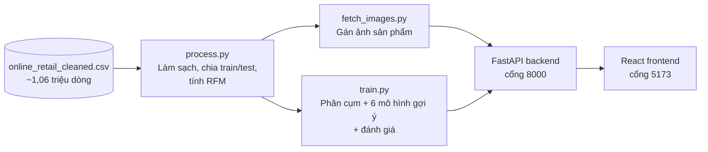

# Personalized Marketing – Mô tả chi tiết dự án

Đồ án Big Data: **phân cụm khách hàng** và **gợi ý sản phẩm cá nhân hóa** trên bộ dữ liệu **Online Retail II** (~1,06 triệu dòng giao dịch của một cửa hàng bán lẻ quà tặng online tại Anh).

> Hướng dẫn cài đặt và chạy: xem [README.md](README.md).

---

## 1. Giới thiệu

### 1.1. Bài toán

Một cửa hàng bán lẻ có hàng nghìn khách và hàng nghìn sản phẩm. Gửi cùng một chương trình khuyến mãi cho tất cả khách vừa tốn kém vừa kém hiệu quả: khách VIP không cần voucher giảm giá nhỏ, còn khách sắp bỏ đi lại cần một lý do để quay lại. Marketing cá nhân hóa giải quyết việc này bằng cách trả lời hai câu hỏi:

1. **Khách này thuộc nhóm nào?** → để chọn đúng chiến dịch.
2. **Khách này nên được gợi ý sản phẩm gì?** → để tăng khả năng mua.

### 1.2. Mục tiêu

- **Phân cụm khách hàng** thành các nhóm có ý nghĩa kinh doanh dựa trên hành vi mua (RFM), kèm gợi ý chiến dịch cho từng nhóm.
- **Xây dựng và so sánh 6 mô hình gợi ý sản phẩm**, từ đơn giản (bán chạy nhất) đến phức tạp (kết hợp nhiều mô hình), đánh giá bằng các chỉ số chuẩn trên dữ liệu tương lai.
- **Xây dựng web demo** để người làm marketing tra cứu khách hàng, xem nhóm, xem gợi ý kèm ảnh sản phẩm và so sánh mô hình.

---

## 2. Dữ liệu

| Thông tin | Giá trị |
|---|---|
| Nguồn | Online Retail II (UCI Machine Learning Repository) |
| Khoảng thời gian | 01/12/2009 – 09/12/2011 (~2 năm) |
| Số dòng ban đầu | 1.062.989 |
| Số dòng sau làm sạch | 776.879 (73,1%) |
| Tập train | 662.166 dòng, 5.502 khách (01/12/2009 – 10/10/2011) |
| Tập test | 114.713 dòng, 2.394 khách (60 ngày cuối: 10/10 – 09/12/2011) |
| Số sản phẩm | 4.624 |

Mỗi dòng là một sản phẩm trong một hóa đơn, gồm: mã hóa đơn, mã sản phẩm, mô tả, số lượng, ngày mua, đơn giá, mã khách hàng, quốc gia.

---

## 3. Kiến trúc hệ thống

Ba script Python chạy **một lần** để chuẩn bị dữ liệu và huấn luyện, kết quả được lưu thành file (Parquet, CSV, pickle, JSON). Backend chỉ nạp các file này và trả kết quả tức thì cho web, không phải xử lý lại hàng triệu dòng mỗi lần có yêu cầu.

| Thành phần | Công nghệ | Vai trò |
|---|---|---|
| Xử lý dữ liệu | pandas, Parquet | Làm sạch, chia tập, tính RFM |
| Mô hình | scikit-learn, SciPy, implicit | K-Means, PCA, TF-IDF, Item-CF (scikit-learn, SciPy); ALS (implicit) |
| Backend | FastAPI, Pydantic | REST API, phục vụ ảnh tĩnh |
| Frontend | React, Vite | Giao diện web |
| Triển khai | Docker Compose, Nginx | Chạy toàn bộ hệ thống bằng một lệnh |

---

## 4. Quy trình xử lý dữ liệu

### 4.1. Làm sạch dữ liệu (`process.py`)

**Bảy bước làm sạch** – loại bỏ những dòng không dùng được hoặc gây nhiễu:

| Bước | Thao tác | Số dòng còn lại | Bị loại |
|---|---|---|---|
| – | Dữ liệu ban đầu | 1.062.989 | – |
| 1 | Bỏ dòng thiếu `customer_id` (không biết ai mua thì không phân cụm, gợi ý được) | 824.364 | 238.625 |
| 2 | Bỏ đơn hủy (mã hóa đơn bắt đầu bằng `C`) | 805.620 | 18.744 |
| 3 | Bỏ dòng có số lượng hoặc giá ≤ 0 | 805.549 | 71 |
| 4 | Bỏ mã không phải sản phẩm: phí ship `POST`, phí ngân hàng, `AMAZONFEE`, `TEST`, ... | 802.939 | 2.610 |
| 5 | Bỏ dòng trùng lặp hoàn toàn | 776.879 | 26.060 |
| 6 | Chuẩn hóa mô tả về chữ thường; mỗi mã sản phẩm lấy mô tả xuất hiện nhiều nhất | 776.879 | 0 |
| 7 | Tính lại `total_price = quantity × price` | 776.879 | 0 |

Sau làm sạch còn **776.879 dòng (73,1%)**. Phần bị loại nhiều nhất là dòng thiếu mã khách hàng (~22% dữ liệu gốc).

### 4.2. Chuẩn bị dữ liệu cho mô hình

**Chia train/test theo thời gian** tại mốc **10/10/2011**: 60 ngày cuối làm tập test (114.713 dòng), phần trước làm tập train (662.166 dòng).

Cách chia này mô phỏng đúng thực tế: dùng quá khứ để đoán tương lai. Nếu chia ngẫu nhiên, tập train sẽ chứa cả giao dịch tương lai, khiến mô hình "biết trước đáp án" và cho điểm cao ảo (rò rỉ dữ liệu – data leakage). 60 ngày là mức cân bằng: đủ dài để nhiều khách kịp quay lại mua, đủ ngắn để tập train vẫn giữ gần 2 năm dữ liệu.

**Tính RFM trên tập train** cho 5.502 khách:

| Chỉ số | Ý nghĩa | Nhỏ nhất | Trung bình | Lớn nhất |
|---|---|---|---|---|
| **Recency** | Số ngày kể từ lần mua cuối | 1 | 205,5 | 679 |
| **Frequency** | Số hóa đơn | 1 | 5,8 | 314 |
| **Monetary** | Tổng tiền đã chi (£) | 2,9 | 2.681,9 | 524.476,6 |

Frequency và Monetary lệch rất mạnh (một vài khách mua sỉ chi hàng trăm nghìn bảng) → cần biến đổi log trước khi phân cụm.

**Ma trận tương tác khách × sản phẩm:** chỉ giữ khách có ≥ 2 hóa đơn và sản phẩm có ≥ 5 lượt mua, vì dữ liệu quá thưa thì mô hình không học được. Từ 418.921 cặp (khách, sản phẩm) còn **381.455 cặp**, gồm **3.820 khách và 4.114 sản phẩm**. Khách không đủ điều kiện vẫn được gợi ý bằng mô hình Popularity.

**Đáp án để chấm điểm (`test_truth`):** những sản phẩm khách thực sự mua trong tập test, chỉ tính khách có trong ma trận tương tác → **71.211 cặp từ 1.730 khách**. Các chỉ số ở mục 6.2 được tính trên 1.730 khách này.

### 4.3. Gán ảnh sản phẩm (`fetch_images.py`)

Bộ dữ liệu gốc không có ảnh, nên ảnh được gán tự động để giao diện trực quan hơn:

- **Tìm ảnh thật** cho từng sản phẩm qua **Pixabay API** (dự phòng: Pexels API):
  - Mô tả sản phẩm được rút gọn thành từ khóa chính: bỏ màu sắc, kích thước, tên dòng sản phẩm; dịch các cụm từ đặc thù (`cakestand` → "cake stand", `t-light` → "tealight candle", `cake cases` → "cupcake liners"...).
  - Chỉ nhận ảnh có thẻ mô tả (tags) khớp với từ khóa, ưu tiên ảnh khớp nhất và chưa dùng cho sản phẩm khác.
  - Sản phẩm bị gán sai ảnh có thể sửa tay từ khóa trong `data/images/_overrides.json`.
- **Không tìm thấy ảnh phù hợp:** dùng ảnh minh họa theo danh mục (túi, nến, đồng hồ, đồ gốm, ...) từ Unsplash.
- Ảnh được cắt vuông 400×400, lưu tại `data/images/<stockcode>.jpg`.
- `_manifest.json` ghi nguồn ảnh của từng sản phẩm, `_query_cache_v2.json` lưu kết quả tìm kiếm → chạy lại sẽ không tải lại ảnh đã có và không tốn thêm lượt gọi API.
- **Kết quả:** 4.610/4.624 sản phẩm (99,7%) có ảnh thật khớp từ khóa, gồm 4.492 ảnh khác nhau; 14 sản phẩm còn lại dùng ảnh tìm theo cách cũ (không có ảnh nào khớp tags). Các biến thể màu của cùng một sản phẩm thường dùng chung ảnh.

> Ảnh được tìm theo từ khóa nên là ảnh **minh họa cùng loại sản phẩm**, không phải ảnh chính xác của sản phẩm đó.

---

## 5. Phương pháp

### 5.1. Phân cụm khách hàng (RFM + K-Means)

- Dữ liệu RFM bị lệch mạnh → biến đổi `log1p` rồi chuẩn hóa `StandardScaler`.
- Thử K = 2 … 10, đánh giá bằng Silhouette Score và Inertia (phương pháp khuỷu tay), chọn **K = 4**.
- Giảm chiều PCA về 2D để vẽ biểu đồ phân tán trên web.

| Nhóm | Đặc điểm | Chiến dịch gợi ý |
|---|---|---|
| **Khách VIP** | Mua gần đây, mua nhiều, chi tiêu cao nhất | Đặc quyền VIP, chăm sóc 1-1 |
| **Khách trung thành** | Mua thường xuyên, chi tiêu khá | Tích điểm đổi quà, ưu đãi mua lại |
| **Khách mới** | Mới mua gần đây nhưng ít đơn, ít tiền | Voucher cho đơn hàng thứ 2 |
| **Khách có nguy cơ rời bỏ** | Lâu rồi không quay lại | Chiến dịch win-back kéo khách quay lại |

### 5.2. Sáu mô hình gợi ý sản phẩm

| # | Mô hình | Ý tưởng |
|---|---|---|
| 1 | **Popularity** | Gợi ý sản phẩm bán chạy nhất toàn hệ thống. Dùng làm mốc so sánh và fallback cho khách mới (cold-start). |
| 2 | **Cluster Popularity** | Gợi ý sản phẩm bán chạy nhất *trong nhóm* của khách. |
| 3 | **Item-CF** | "Ai mua món A cũng hay mua món B" – độ giống nhau giữa sản phẩm tính bằng Cosine Similarity trên lịch sử mua. |
| 4 | **ALS** | Phân rã ma trận khách × sản phẩm để tìm sở thích ẩn (implicit feedback). |
| 5 | **Content-Based** | Gợi ý sản phẩm có mô tả giống những món khách đã mua (TF-IDF + Cosine Similarity). |
| 6 | **Hybrid** | Kết hợp điểm của ALS, Content-Based và Cluster Popularity sau khi chuẩn hóa Min-Max. |

Công thức Hybrid:

$$\text{Score} = 0.5 \times \text{ALS} + 0.2 \times \text{Content} + 0.3 \times \text{Cluster-Pop}$$

<!-- TODO: ghi rõ trọng số được chọn bằng cách nào (thử nghiệm / tinh chỉnh trên tập validation / chọn thủ công) -->

Popularity và Cluster Popularity là **mốc so sánh** (không cá nhân hóa, hoặc chỉ cá nhân hóa theo nhóm); bốn mô hình còn lại cá nhân hóa theo từng khách.

---

## 6. Kết quả thực nghiệm

### 6.1. Phân cụm khách hàng (K = 4)

| Chỉ số | Giá trị | Cách đọc |
|---|---|---|
| Silhouette Score | 0,3839 | Từ -1 đến 1, càng cao càng tốt. Mức ~0,38 cho thấy các cụm tách nhau **ở mức khá**. |
| Davies-Bouldin Index | 0,8773 | Càng nhỏ càng tốt. Dưới 1 là các cụm tương đối gọn và tách biệt. |
| Calinski-Harabasz | 4.838,22 | Càng lớn càng tốt. Đo tỷ lệ khác biệt giữa các cụm so với bên trong cụm. |

### 6.2. Gợi ý sản phẩm trên tập test (top 10)

**Cách đọc các chỉ số:**

- **Precision@10** – trong 10 món gợi ý, bao nhiêu % khách thực sự mua trong tập test.
- **Recall@10** – trong những món khách thực sự mua, bao nhiêu % nằm trong 10 món gợi ý.
- **MAP@10, NDCG@10** – như Precision nhưng có tính thứ tự: món đúng xếp càng cao thì điểm càng cao.
- **Coverage@10** – bao nhiêu % sản phẩm trong cửa hàng từng được gợi ý cho ít nhất một khách. Cao nghĩa là gợi ý đa dạng, không chỉ xoay quanh vài món bán chạy.

| Mô hình | Precision@10 | Recall@10 | MAP@10 | NDCG@10 | Coverage@10 |
|---|---|---|---|---|---|
| Popularity | 9,06% | 2,89% | 4,66% | 10,24% | 0,24% |
| Cluster Popularity | 9,73% | 3,13% | 5,01% | 10,94% | 0,44% |
| Item-CF | **19,43%** | 9,19% | **13,52%** | **22,37%** | 22,05% |
| ALS | 10,16% | 6,64% | 5,68% | 11,30% | 42,66% |
| Content-Based | 17,85% | 8,77% | 12,51% | 21,00% | **45,14%** |
| **Hybrid (đề xuất)** | 19,14% | **10,20%** | 12,94% | 22,28% | 37,31% |

*In đậm: giá trị tốt nhất của mỗi cột.*

**Nhận xét:**

- **Popularity và Cluster Popularity** có độ chính xác thấp nhất và gần như chỉ gợi ý vài chục món giống nhau cho mọi khách (Coverage < 0,5%).
- **Item-CF** chính xác nhất (Precision, MAP, NDCG cao nhất), nhưng chỉ bao phủ ~22% sản phẩm.
- **Hybrid** có **Recall cao nhất**, độ chính xác chỉ kém Item-CF rất ít (19,14% so với 19,43%), đổi lại gợi ý được nhiều loại sản phẩm hơn (Coverage 37% so với 22%). Đây là lý do Hybrid được chọn làm mô hình mặc định.

---

## 7. Hạn chế

- Tập test (60 ngày cuối, 10/10 – 09/12/2011) rơi vào **mùa mua sắm Giáng sinh**, nên kết quả có thể chịu ảnh hưởng mùa vụ.
- Mới đánh giá trên một mốc cắt thời gian; có thể thử thêm 30/90 ngày hoặc đánh giá cuốn chiếu (rolling evaluation) để kiểm tra độ ổn định.
- Trọng số Hybrid chưa được tinh chỉnh trên một tập validation riêng.
- Một số mã không phải sản phẩm (`ADJUST`, `C2`, `PADS`, ...) vẫn còn trong danh mục sản phẩm.
- Ảnh sản phẩm là ảnh minh họa theo từ khóa, không phải ảnh thật của sản phẩm.

---

## 8. Hướng phát triển

Kế hoạch đến hạn nộp (tháng 12/2026), theo thứ tự ưu tiên:

| # | Tính năng | Mô tả |
|---|---|---|
| 0 | **Dọn dẹp dữ liệu** | Loại các mã không phải sản phẩm còn sót; tách tập validation để chọn trọng số Hybrid |
| 1 | **Giải thích gợi ý** | Mỗi món gợi ý kèm lý do, ví dụ "Vì bạn đã mua *White Hanging Heart T-Light Holder*" (dựa trên độ tương đồng Item-CF / Content-Based) |
| 2 | **Luật kết hợp (FP-Growth)** | Mục "Thường được mua cùng" và trang các luật kết hợp kèm support, confidence, lift; có thể triển khai bằng PySpark |
| 3 | **Giỏ hàng demo** | Người xem thêm sản phẩm vào giỏ, danh sách gợi ý cập nhật ngay theo giỏ |
| 4 | **Chân dung & chiến dịch tự động** | Từ số liệu từng nhóm (RFM trung bình, top sản phẩm, quốc gia, mùa mua), tự sinh mô tả chân dung khách và gợi ý chiến dịch bằng luật + LLM |
| 5 | **Gợi ý theo từng phân khúc** | Mỗi nhóm khách một chiến lược gợi ý / bộ trọng số Hybrid riêng; so sánh với một công thức chung bằng chỉ số đánh giá theo từng nhóm |
| 6 | **Hoàn thiện giao diện** | Cải thiện màu sắc, bố cục, thẻ sản phẩm |

Các hướng mở rộng khác: dự đoán khách sắp rời bỏ (churn), dự đoán giá trị vòng đời khách (CLV), gợi ý theo mùa vụ, gợi ý theo độ giống hình ảnh (CLIP), email cá nhân hóa bằng LLM.
